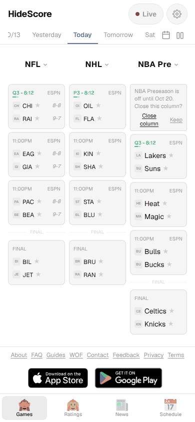
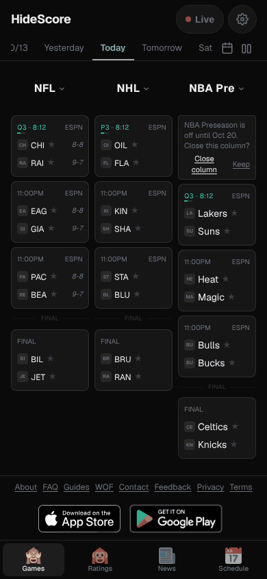
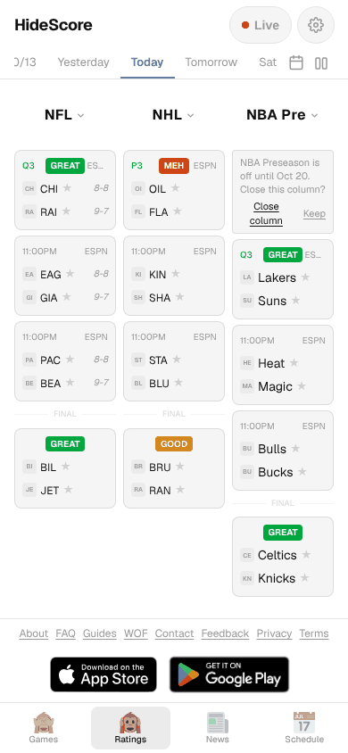
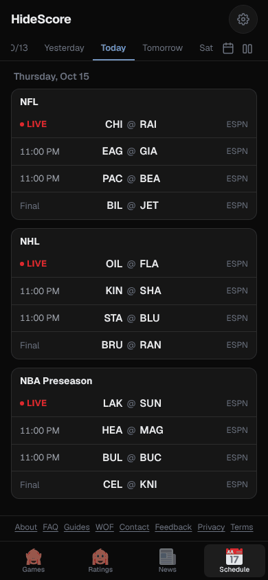
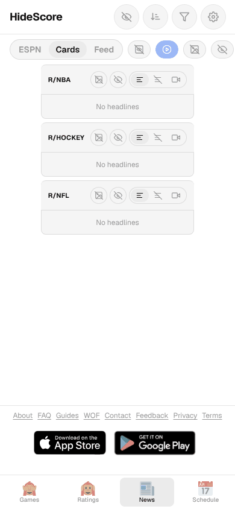
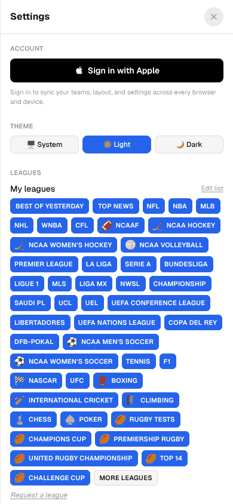

# Design check: HideScore vs ESPN, theScore, FotMob (2026-10-15)

Docs only. No code changes.

## How this check was done

- I read the app code: `HomeContent.tsx` (phone shell, tab bar, News toolbar), `DateNav.tsx`, `GameCard.tsx`, `LeagueColumn.tsx`, `LeaguePickerModal.tsx`, `SettingsPanel.tsx`, `globals.css`, `lib/nativeTabBar.ts`, `lib/widgetBridge.ts`.
- The phone tabs are now **Games · Ratings · News · Schedule**. The Leagues tab went out on 10/14 (#384).
- I ran `next dev` and took screenshots at 390 px and 1440 px, light and dark. They are in `docs/reports/design-check-2026-10-15/`.
- The session network blocks the ESPN API. So the board in the screenshots uses mock games (NFL, NHL, NBA, one live, two upcoming, one final per league). The layout is real. The teams and times are not.
- The session network also blocks apps.apple.com, play.google.com, espn.com, thescore.com and fotmob.com. So every rival claim comes from a **search-result snippet**, not from a page I opened. Each claim has its link. Check a link before you quote it in public.
- I did not sign in anywhere.

### Screenshots

| Phone, light | Phone, dark | Ratings | Schedule (dark) | News | Settings |
|---|---|---|---|---|---|
|  |  |  |  |  |  |

Desktop: [games dark](design-check-2026-10-15/games-1440-dark.png) · [games light](design-check-2026-10-15/games-1440-light.png) · [schedule](design-check-2026-10-15/schedule-1440-light.png) · [news](design-check-2026-10-15/news-1440-light.png).

The News shots show "No headlines" because the session blocks Reddit and ESPN. The toolbar is real.

## 1. Top 15 changes, ranked by user value / effort

Spoiler risk: **None** = shows nothing new about a game. **Low** = new surface, but it carries only state we already show. **High** = new surface that a rival uses to send results; it needs the adaptation in the row.

### 1. Fix two low-contrast colours

- **What:** Make `--text-muted` darker in light mode. Make the live clock (`text-green-500`) darker in light mode.
- **Why:** `--text-muted` is `#999999` on white. `globals.css` itself says it is 2.8:1. The live "Q3 · 8:12" text is Tailwind green-500 on `#f5f5f5`, near 2.2:1. Both fail WCAG AA (4.5:1). No rival publishes an accessibility statement. VoiceOver users report unlabelled ESPN buttons ([AppleVis](https://applevis.com/comment/2371)). Clean accessibility is a cheap way to beat all three.
- **Where:** `src/app/globals.css` (`--text-muted`, line 318), `src/components/GameCard.tsx` lines 893–894.
- **Effort:** S. **Spoiler risk:** None.

### 2. Make the tab bar real tabs, and make the labels bigger

- **What:** Give the bar `role="tablist"`, each tab `role="tab"` and `aria-selected`. Raise labels from 10 px to 11–12 px on phone.
- **Why:** Today the tabs are toggle buttons (`aria-pressed`). A screen reader says "toggle button", not "tab 2 of 4". `NflPlayoffPanel.tsx` already uses the right pattern. ESPN gets VoiceOver complaints ([AppleVis](https://applevis.com/comment/2371)).
- **Where:** `src/components/HomeContent.tsx` `BottomTabBar` (lines 228–309). The iOS native bar in `lib/nativeTabBar.ts` is not affected.
- **Effort:** S. **Spoiler risk:** None.

### 3. Loading skeletons and one shared error banner

- **What:** Show grey card shapes while a column loads. When feeds fail, show one banner with one Retry and auto-retry, not a "Schedule unavailable / Retry" block in each column.
- **Why:** With feeds down, the phone showed three "Schedule unavailable" blocks side by side. Rivals sell speed: FotMob advertises "live scores with instant goal notifications" ([App Store](https://apps.apple.com/US/app/id488575683)); theScore calls Scores "a live view of every game updated in real time" ([listing mirror](https://marlvel.ai/intel-report/sports/iphone-thescore-com)). Skeletons make a slow load feel fast.
- **Where:** `src/components/LeagueColumn.tsx` (loading and error branches), `src/components/HomeContent.tsx` (board-level fetch state), `src/lib/offlineBoard.ts` (show the cached board under the banner).
- **Effort:** S. **Spoiler risk:** None. A skeleton must not hint at card order by result.

### 4. Say plainly what rivals still leak

- **What:** Add a short, sourced comparison to the "best spoiler-free sites" page and to the store text.
- **Why:** ESPN's only official switch is "Live Score Data" under Video Settings. It hides scores on live video tiles and must be set on each device ([ESPN help](https://support.espn.com/hc/en-us/articles/6535549980564-How-can-I-hide-live-scores-from-being-shown)). Scores still show in headlines, push and the ticker ([No Look Sports](https://www.nolooksports.com/guides/best-apps-hide-scores/)). theScore and FotMob only let you mute alerts ([Visboo](https://www.visboo.com/spoiler-free-sports-score-apps/)). This is our main reason to exist. The page does not say it today.
- **Where:** `src/app/best-spoiler-free-sports-sites/page.tsx`, `APP_STORE_SUBMISSION.md`, `PLAY_STORE_SUBMISSION.md`.
- **Effort:** S. **Spoiler risk:** None.

### 5. One full-width list on the phone (stacked leagues)

- **What:** At phone width, offer (and test as default) one column of full-width cards: league header, then its games, then the next league. Keep the 3-column board as an option.
- **Why:** At 390 px each of the 3 columns is about 115 px wide. Team names drop to 3 letters ("CHI", "RAI") and the record wraps. FotMob groups games into league cards that expand and collapse, one under the other ([Pratt IxD critique](https://ixd.prattsi.org/2021/09/design-critique-fotmob-android-app/)). theScore lists "the leagues you follow in the order you follow them" ([Droid Life](https://www.droid-life.com/?p=206250)). Our Schedule tab already has this shape and reads much better at 390 px.
- **Where:** `src/components/HomeContent.tsx` (`slotCount`, line 1566, and the board render), `src/components/LeagueColumn.tsx`, `src/components/GameCard.tsx` (full names when wide). Reuse the Schedule tab layout.
- **Effort:** M. **Spoiler risk:** None. Cards stay the same. Order must stay live → upcoming → final, never by margin.

### 6. Add a favourite-teams step to first run

- **What:** After the league picker, offer "Pick your teams" with search and Follow toggles. Allow Skip.
- **Why:** FotMob onboarding goes teams → leagues → players, with search and suggested teams ([Lazyweb flow](https://lazyweb.com/canvas/flows/fotmob/onboarding)). ESPN asks you to "pick favourite leagues and teams to start" ([App Store](https://apple.co/2Gv64Ld)). We have favourite teams, but only behind a star on each card or in Settings.
- **Where:** `src/components/LeaguePickerModal.tsx`, first-run effect in `src/components/HomeContent.tsx` (lines 2701–2720), `src/lib/preferences.ts` (`favoriteTeams`), `src/lib/widgetBridge.ts` (the Android widget already reads favourite teams).
- **Effort:** M. **Spoiler risk:** Low. The team list shows names and logos only. No records, ranks or standings, even though rivals show them in pickers.

### 7. "My teams" row at the top of Games

- **What:** A thin row above the board with the next or current game of each favourite team, across leagues.
- **Why:** theScore shows favourites as reorderable chips at the top of the screen ([App Store](https://apps.apple.com/us/app/-/id285692706)) and has a Favorites tab ([theScore](https://www.thescore.com/news/1355628)). ESPN has a favourites feed "front and centre" ([App Store](https://apple.co/2Gv64Ld)).
- **Where:** `src/components/HomeContent.tsx`, `src/lib/favoritesFilter.ts`, `src/components/GameCard.tsx` (compact variant).
- **Effort:** M. **Spoiler risk:** Low. Show start time, "Live · Q3" or "Final" only. A final shows a rating only on the Ratings tab, same gate as now (`lib/ratingGate.ts`). Never "W" / "L" next to a team.

### 8. Dots on the date strip for days with favourite-team games

- **What:** A small dot under a day chip when a favourite team plays that day.
- **Why:** FotMob uses a horizontal scrolling date bar ([Pratt IxD critique](https://ixd.prattsi.org/2021/09/design-critique-fotmob-android-app/)); ESPN added calendars to browse full schedules ([APKMirror notes](https://www.apkmirror.com/apk/disney/espn/espn-6-1-0-release)). Our strip (`variant="strip"`, ±7 days) already copies FotMob, but every day looks the same.
- **Where:** `src/components/DateNav.tsx` (strip variant), `src/lib/upcomingSlate.ts`.
- **Effort:** S. **Spoiler risk:** None. A dot means "a game exists". It must not change colour for past days by result.

### 9. Calm the News toolbar

- **What:** Keep the view switch (ESPN · Cards · Feed). Move the other toggles (Show all, Autoplay, Media, Headlines, All / No text / Videos) into one labelled "Filters" sheet.
- **Why:** At 390 px the News tab has 4 header icons plus a row of 8 controls that runs off the screen. Most controls are icon-only. FotMob shows News as one of five plain bottom tabs ([Lazyweb](https://lazyweb.com/canvas/flows/fotmob/onboarding)).
- **Where:** `src/components/HomeContent.tsx` (News header, `NewsFilterList`), `src/lib/useNewsToolbar.ts`, `src/components/NewsColumn.tsx`.
- **Effort:** M. **Spoiler risk:** Low. News is the full-spoiler zone. Keep `NewsSpoilerConfirm` and the blur default exactly as now.

### 10. Settings › Leagues: search and drag to reorder

- **What:** Replace the wall of 40+ all-caps chips with a searchable list grouped by sport, with drag handles.
- **Why:** FotMob: follow leagues, then Edit and drag; that order sets the Matches order ([FotMob help](https://www.fotmob.com/da/topnews/20167-how-add-hide-leagues-fotmob)). theScore: "Tap 'Manage' to add, delete or reorder your favorites" ([App Store](https://apps.apple.com/us/app/-/id285692706)). On a 390 px phone our Leagues section fills the whole first screen of Settings.
- **Where:** `src/components/SettingsPanel.tsx` (Leagues section, line 1356; "Edit list" mode, line 1387), `src/lib/switcherOptions.ts`.
- **Effort:** M. **Spoiler risk:** None.

### 11. Respect the phone text size

- **What:** Size card and tab text in `rem` and follow the iOS / Android text-size setting in the app shells.
- **Why:** `GameCard.tsx` has 13 fixed `text-[10px]` / `text-[9px]` sizes. FotMob lists accessibility features on its store page ([App Store](https://apps.apple.com/US/app/id488575683)). Low-vision users are a group no rival serves well ([AppleVis on ESPN](https://applevis.com/comment/2371)).
- **Where:** `src/components/GameCard.tsx`, `src/app/globals.css`, `ios/App/App/MainViewController.swift` (text zoom), `android/.../MainActivity.java`.
- **Effort:** M. **Spoiler risk:** None. Check that bigger text does not push a masked title into view.

### 12. iOS home-screen widget

- **What:** Port the Android widget (favourite teams, next games, theme) to iOS WidgetKit.
- **Why:** FotMob sells "home screen widgets with news and live matches" ([App Store](https://apps.apple.com/US/app/id488575683)). We already have it on Android (`HideScoreWidget*.java`).
- **Where:** new WidgetKit target in `ios/App`, `src/lib/widgetBridge.ts` (add the iOS plugin path).
- **Effort:** L. **Spoiler risk:** Low. Same rule as Android: times and "Live" only. A rating tier only if the user turned on Ratings. Never a score.

### 13. Spoiler-safe alerts

- **What:** Opt-in push for "starts in 15 min", "Live now", and "This one is turning GREAT — tune in". Never a final or a score.
- **Why:** theScore has per-game alerts from a bell on the game ([theScore help](https://thescoresupport.zendesk.com/hc/en-us/articles/13873293585037-Setting-up-Alerts-for-Individual-Games)). FotMob sends instant goal alerts ([App Store](https://apps.apple.com/US/app/id488575683)). ESPN alerts for teams and leagues ([App Store](https://apple.co/2Gv64Ld)), and pushes still show scores with the spoiler toggle on ([No Look Sports](https://www.nolooksports.com/guides/best-apps-hide-scores/)).
- **Where:** new push path in `ios/App/App/AppDelegate.swift` and the Android shell; alert copy built in `src/lib/spoilers.ts`; per-game bell in `GameCard.tsx`.
- **Effort:** L. **Spoiler risk:** High. Adapt: no goal / score / final alerts. "Tune in" fires on the live rating crossing a tier, and the copy is fixed text ("A game you follow is getting good"). Lock-screen text must pass the same title-mask check as highlights (`npm run qa:titlemask`). An alert must never say "comeback" or "upset", as that names a trend.

### 14. Spoiler-safe Live Activity

- **What:** Lock screen / Dynamic Island card for one live game: teams, period, clock. No score.
- **Why:** theScore pins up to 5 games with sport-specific state such as bases, outs, down and distance ([theScore](https://thescore.com/news/2885302)). ESPN has Live Activities for NBA, NHL, NFL and college football ([App Store](https://apps.apple.com/us/app/-/id317469184)). FotMob was an early adopter ([Airship](https://www.airship.com/?p=28609)).
- **Where:** new ActivityKit target in `ios/App`, data from `src/lib/liveProgress.ts`.
- **Effort:** L. **Spoiler risk:** High. Adapt: period and clock only. Drop possession, bases and down and distance, as they hint at the game flow. No score field in the payload at all, so a bug cannot show one.

### 15. A highlights feed for games you already chose to see

- **What:** A vertical clip feed, but only for games the user has opened, or for "Watch later" games after the user taps Reveal.
- **Why:** ESPN added "Verts", a vertical-video tab, in its 2025 relaunch ([ESPN press](https://espnpressroom.com/us/press-releases/2025/08/espn-launches-new-direct-to-consumer-service-enhanced-espn-app/)).
- **Where:** `src/components/AlignedVideoStrip.tsx`, `src/components/WatchQueueContext.tsx`, `src/lib/highlights.ts`, `src/lib/youtube.ts`.
- **Effort:** L. **Spoiler risk:** High. ESPN's feed is result-first; drop that. Keep: no autoplay into the next game, masked titles and thumbnails (`lib/mediaSafe.ts`), and no clip from a game the user has not opened.

### Ideas dropped for spoiler reasons

- **Red cards and goals on the match list** (FotMob, [APKMirror notes](https://apkmirror.com/apk/fotmob-as/fotmob-live-soccer-scores/fotmob-live-soccer-scores-181-11231-20231213-release)): dropped. A red card changes how a match is read.
- **Player follow with red-card alerts** (theScore, [theScore](https://www.thescore.com/worldcup/news/3565103/follow-your-new-favorite-soccer-stars-with-the-score-app)): drop the alert. A "player plays tonight" note is safe.
- **Odds and lines on the game page** (theScore, [listing mirror](https://marlvel.ai/intel-report/sports/iphone-thescore-com)): dropped. Live odds tell you who is winning.
- **AI "SportsCenter for you"** (ESPN, [ESPN press](https://espnpressroom.com/us/press-releases/2025/08/espn-launches-new-direct-to-consumer-service-enhanced-espn-app/)): dropped. A recap is the result.

## 2. Per-rival tables

### ESPN (App Store 4.6, about 4.06M ratings, [TechDevNotes](https://techdevnotes.com/apps/ios/espn/317469184))

| ESPN does better | We do better |
|---|---|
| Live Activities in the Dynamic Island ([App Store](https://apps.apple.com/us/app/-/id317469184)) | Spoiler-free by default on every surface. ESPN hides scores only on live video tiles, per device ([ESPN help](https://support.espn.com/hc/en-us/articles/6535549980564-How-can-I-hide-live-scores-from-being-shown); [No Look Sports](https://www.nolooksports.com/guides/best-apps-hide-scores/)) |
| Video in the app: multiview, StreamCenter, Verts ([ESPN press](https://espnpressroom.com/us/press-releases/2025/08/espn-launches-new-direct-to-consumer-service-enhanced-espn-app/)) | A 1–5 worth-watching rating per game; ESPN has none |
| Teams and leagues picked at start, favourites feed ([App Store](https://apple.co/2Gv64Ld)) | Simple 4-tab app with no account needed; ESPN users say spoilers are "not easy" to turn off ([App Store](https://apps.apple.com/us/app/-/id317469184)) |

### theScore (App Store 4.8, about 833K ratings, [Marlvel](https://marlvel.ai/intel-report/sports/iphone-thescore-com))

| theScore does better | We do better |
|---|---|
| Live Activities for up to 5 games, sport-specific state ([theScore](https://thescore.com/news/2885302)) | No spoiler mode in theScore; feeds "surface scores prominently" ([Visboo](https://www.visboo.com/spoiler-free-sports-score-apps/)) |
| Per-game alert bell with alert-type choice ([theScore help](https://thescoresupport.zendesk.com/hc/en-us/articles/13873293585037-Setting-up-Alerts-for-Individual-Games)) | Ratings tell you what to watch without a box score |
| Favourite chips at the top, "Manage" to reorder ([App Store](https://apps.apple.com/us/app/-/id285692706)) | No betting odds anywhere; theScore shows odds and lines on the game page ([Marlvel](https://marlvel.ai/intel-report/sports/iphone-thescore-com)) |

### FotMob (App Store 4.9, about 151K ratings, [App Store](https://apps.apple.com/US/app/id488575683))

| FotMob does better | We do better |
|---|---|
| Home-screen widgets on iOS and Android ([App Store](https://apps.apple.com/US/app/id488575683)) | No spoiler mode in FotMob; only per-match alert mutes ([Visboo](https://www.visboo.com/spoiler-free-sports-score-apps/)) |
| Onboarding: teams → leagues → players, with search ([Lazyweb](https://lazyweb.com/canvas/flows/fotmob/onboarding)) | 40+ leagues across many sports; FotMob is football only ([APKMirror](https://apkmirror.com/apk/fotmob-as/fotmob-live-soccer-scores/fotmob-live-soccer-scores-181-11231-20231213-release)) |
| Follow leagues and drag to set the Matches order ([FotMob help](https://www.fotmob.com/da/topnews/20167-how-add-hide-leagues-fotmob)) | Web, iOS, Android and Apple TV from one build; settings sync with Sign in with Apple |

## 3. Sources

All rival links below were read as search-result snippets. The session could not open the pages.

ESPN
- https://support.espn.com/hc/en-us/articles/6535549980564-How-can-I-hide-live-scores-from-being-shown
- https://www.nolooksports.com/guides/best-apps-hide-scores/
- https://apps.apple.com/us/app/-/id317469184
- https://apple.co/2Gv64Ld
- https://espnpressroom.com/us/press-releases/2025/08/espn-launches-new-direct-to-consumer-service-enhanced-espn-app/
- https://www.apkmirror.com/apk/disney/espn/espn-6-1-0-release
- https://applevis.com/comment/2371
- https://techdevnotes.com/apps/ios/espn/317469184

theScore
- https://apps.apple.com/us/app/-/id285692706
- https://marlvel.ai/intel-report/sports/iphone-thescore-com
- https://thescore.com/news/2885302
- https://thescoresupport.zendesk.com/hc/en-us/articles/13873293585037-Setting-up-Alerts-for-Individual-Games
- https://www.thescore.com/news/1355628
- https://www.droid-life.com/?p=206250
- https://www.thescore.com/worldcup/news/3565103/follow-your-new-favorite-soccer-stars-with-the-score-app
- https://www.visboo.com/spoiler-free-sports-score-apps/

FotMob
- https://apps.apple.com/US/app/id488575683
- https://lazyweb.com/canvas/flows/fotmob/onboarding
- https://www.fotmob.com/da/topnews/20167-how-add-hide-leagues-fotmob
- https://ixd.prattsi.org/2021/09/design-critique-fotmob-android-app/
- https://apkmirror.com/apk/fotmob-as/fotmob-live-soccer-scores/fotmob-live-soccer-scores-181-11231-20231213-release
- https://www.airship.com/?p=28609
- https://www.visboo.com/spoiler-free-sports-score-apps/
